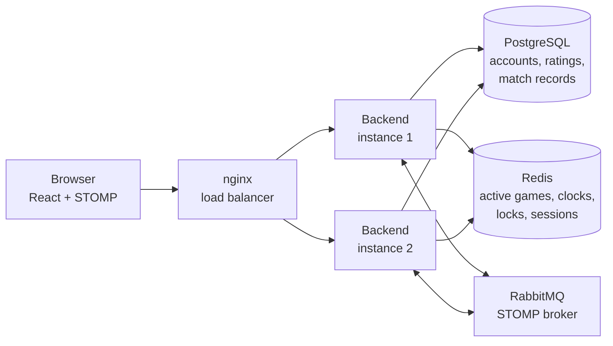
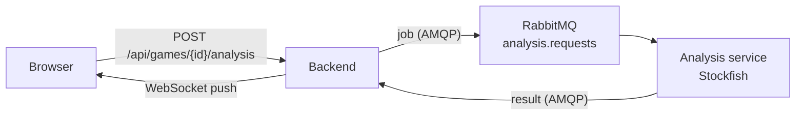

# Chess Platform

[](https://github.com/zilid10/chess-platform/actions/workflows/ci.yaml)
[](LICENSE)


A real-time multiplayer chess platform with a chess engine written from scratch, live clocks, Elo ratings, and a
backend that scales horizontally: any number of instances can serve the same game.

Players create a game on a clock such as `5+3`, share its ID, and play over WebSockets. Others who open the same game
watch it live and can chat. Finished games are rated, archived with their PGN, and listed in each player's history,
where a player can have Stockfish review the game move by move.

---

## Features

**Play**

- Real-time games over STOMP WebSockets, with spectators and in-game chat
- Eleven clock settings, from `1+0` bullet to `30+20` classical, with increments
- Games end on time even if a player disconnects: the server runs the clocks, not the browser
- Unstarted games are aborted: White has 30 seconds to make a first move, then Black has 30 seconds to reply
- Resignation, draw offers, and every standard ending: checkmate, stalemate, threefold repetition, the fifty-move rule,
  insufficient material, and a draw when time runs out but the opponent could never checkmate

**Compete**

- Separate Elo ratings for bullet, blitz, rapid, and classical, starting at 1200
- A K-factor that settles as players gain experience: 40 for a player's first 20 games, then 20 up to a 2100 rating,
  then 10
- Game history with rating changes, and PGN you can download or copy

**Review**

- Engine analysis of any archived game on request: an evaluation for every move, the inaccuracies, mistakes and
  blunders with the better move, and a short summary, shown on a board you can step through

**Connect**

- Accounts with profiles, and friend requests you can send, accept, or reject
- Session login shared across every backend instance

---

## Highlights

### A chess engine built from scratch

The rules engine in `backend/.../chess/` has no framework dependencies. It includes:

- legal move generation, with check detection, castling through unattacked squares, en passant, and promotion to any
  piece;
- move application with full undo;
- FEN and UCI parsing, and SAN and PGN output with file, rank, and square disambiguation.

A perft suite counts every legal move sequence from standard test positions and compares the totals with published
references, such as 197,281 positions at depth 4 from the starting position. That catches bugs in how castling,
en passant, promotion, and check interact.

### Clocks the server can enforce

Each player's clock deadline is indexed in a Redis sorted set. A sweeper checks it every 250 ms and ends overdue games,
so a player who disconnects still loses on time. Each game is updated under a per-game Redis lock, so when several
instances notice the same timeout, only one ends the game, publishes the result, and archives the match. Clients can
also claim a flag the moment a clock hits zero, but the server decides using its own clock.

### Horizontal scaling

Nothing about a game lives in one instance's memory:

- **Active games** are stored in Redis and changed under per-game locks, so concurrent moves are serialized across
  instances.
- **Login sessions** are stored in Redis with Spring Session.
- **WebSocket subscriptions** live in RabbitMQ through Spring's STOMP broker relay. A move handled by one instance
  reaches players connected to another, including private `/user/...` messages.

Docker Compose runs two backend instances behind nginx with the `app` profile.



### AI game analysis

A player can ask for an analysis of any archived game: an evaluation for every move, the inaccuracies, mistakes and
blunders with the better move, and a short summary. It opens from **History → Analyze** as a board you can step
through.

The work runs in a separate, stateless Python service (`analysis/`: FastAPI, `python-chess`, Stockfish), not in the
backend. The backend owns games, users and auth, stores the results in PostgreSQL, and talks to the service only
through RabbitMQ:



- **Versioned contracts.** Every message carries a `schemaVersion`. The golden examples in `contracts/analysis/v1/`
  are checked by both the Java and the Python tests.
- **Idempotent jobs.** One analysis per match; a repeated request returns the same job, and a duplicate or late result
  is ignored, because every state change is a conditional statement.
- **Failure handling.** A job that nobody answers is failed with `TIMED_OUT` after three minutes, by any backend
  instance. Unreadable messages go to dead-letter queues you can inspect in the RabbitMQ UI. A request made while
  the service is down is refused right away with "temporarily unavailable", and the rest of the platform is unaffected.

**Eval.** The labels are checked against 25 Lichess games that carry Lichess's own computer analysis, plus 3 games
exported from this platform. CI reruns it on every push
([full report](analysis/eval/report.md)). With Stockfish 17.1 at depth 16:

| #   | Metric                                       | Result                                   | Pass                             |
| --- | -------------------------------------------- | ---------------------------------------- | -------------------------------- |
| E1  | Games analyzed                               | 28/28                                    | all                              |
| E2  | Same result on a second run                  | identical                                | identical                        |
| E3  | Mistakes and blunders found, vs Lichess      | recall 0.84, precision 0.86              | recall ≥ 0.80, precision ≥ 0.80  |
| E4  | Lichess blunders we also call blunders       | 78%; 2 called good                       | ≥ 75%; at most 2 called good     |
| E5  | Median eval difference from Lichess          | 15 centipawns                            | ≤ 50                             |
| E6  | Time per game (p95)                          | 22.8 s on an M-series Mac                | ≤ 60 s on the CI runner          |

E3 and E4 were lowered from recall ≥ 0.85 and at most 1 called good, with sign-off, because depth 16 cannot
match Lichess's deeper analysis on every move; the reasons are in the spec (§14, "Phase 3 as built").

The design and its trade-offs are in [`docs/specs/ai-analysis.md`](docs/specs/ai-analysis.md).

---

## Tech Stack

| Area           | Technologies                                                                                           |
| -------------- | ------------------------------------------------------------------------------------------------------ |
| Backend        | Java 25 (virtual threads), Spring Boot 4.1, Spring Security, Spring WebSocket (STOMP), Spring Data JPA |
| Data           | PostgreSQL 17.5 with Flyway migrations, Redis 8.6 with Spring Session                                  |
| Messaging      | RabbitMQ 4.1: external STOMP broker for WebSockets, AMQP for analysis jobs                             |
| Analysis       | Python 3.15, FastAPI, python-chess, Stockfish, Pydantic, aio-pika, uv, ruff, pyrefly, pytest           |
| Frontend       | React 19, TypeScript, Vite, Tailwind CSS, react-chessboard, chess.js, STOMP.js                         |
| Quality        | JUnit, Mockito, Testcontainers, JSpecify with NullAway, Vitest, ESLint, Gatling                        |
| Infrastructure | Docker Compose, nginx, GitHub Actions                                                                  |

---

## Getting Started

You need Docker and Docker Compose. These ports must be free: 3000, 8080, 5432, 6379, 5672, 61613, and 15672.

```bash
docker compose --profile app up --build
```

The `app` profile runs the whole application with the same layout as production, though with the `dev` Spring
profile by default (`SPRING_PROFILES_ACTIVE`). Compose starts PostgreSQL, Redis, and RabbitMQ,
then two backend instances, which apply the database migrations on startup, and the frontend behind an nginx gateway
(`nginx.conf`). The gateway routes `/api` and `/ws` to the backend instances and everything else to the frontend. To
run more or fewer instances, add `--scale backend=<n>` or change `deploy.replicas` under `backend` in `compose.yaml`;
the gateway picks up the change within about 10 seconds.

| Service                         | URL                                           |
| ------------------------------- | --------------------------------------------- |
| Frontend                        | http://localhost:3000                         |
| REST API                        | http://localhost:8080/api                     |
| API documentation (dev profile) | http://localhost:8080/swagger-ui.html         |
| Health check                    | http://localhost:8080/actuator/health         |
| RabbitMQ management UI          | http://localhost:15672 (`chess` / `password`) |

### Local development

Without the profile, Compose starts only PostgreSQL, Redis, and RabbitMQ:

```bash
docker compose up -d
```

Run the backend from your IDE (or `./mvnw spring-boot:run -Dspring-boot.run.profiles=dev` in `backend/`) with the
`dev` profile, which connects to those services on `localhost`. Then run `npm run dev` in `frontend/` with Node 24: Vite
serves the frontend on port 3000 and proxies `/api` and `/ws` to the backend on port 8080, so the URLs above stay the
same.

To try a game, register two accounts and sign in from two browsers, or from a normal and a private window. Create a
game on one, then join it from the other with the game ID.

To try game analysis locally, also run the analysis service. It needs Stockfish (`brew install stockfish`) and uses the
same RabbitMQ, which is why Compose publishes port 5672:

```bash
cd analysis
uv run uvicorn analysis.main:app --port 8000
```

Without it, the backend still works: requesting an analysis answers "temporarily unavailable".

The credentials in `compose.yaml` and `application-dev.yaml` are for local development only.

### Configuration

The backend reads these environment variables. Templates: `.env.example` for Docker Compose, which sets them from a
few credentials, and `backend/.env.example` for deploying the backend on its own.

| Variable                                                   | Purpose                                                                                  |
| ---------------------------------------------------------- | ---------------------------------------------------------------------------------------- |
| `SPRING_PROFILES_ACTIVE`                                   | `dev` locally: API docs, all actuator endpoints, debug logging. Unset in production.     |
| `SPRING_DATASOURCE_URL`, `_USERNAME`, `_PASSWORD`          | PostgreSQL connection                                                                    |
| `SPRING_DATA_REDIS_HOST`, `_PORT`                          | Redis connection                                                                         |
| `APP_ALLOWED_ORIGINS`                                      | Comma-separated frontend origins allowed for HTTP and WebSocket requests                 |
| `SPRING_RABBITMQ_HOST`, `_PORT`, `_USERNAME`, `_PASSWORD`  | RabbitMQ AMQP connection, for analysis jobs                                              |
| `APP_WEBSOCKET_RELAY_ENABLED`                              | Route WebSocket messages through RabbitMQ. Required when running more than one instance. |
| `APP_WEBSOCKET_RELAY_HOST`, `_PORT`, `_LOGIN`, `_PASSCODE` | RabbitMQ STOMP connection                                                                |

---

## Testing

From `backend/`:

```bash
./mvnw test     # unit tests, no Docker needed
./mvnw verify   # also runs the integration tests
```

Integration tests (`*IT`) start PostgreSQL, Redis, and RabbitMQ with Testcontainers and apply the migrations with
Flyway, so they only need a running Docker daemon. `WebSocketRelayIT` starts two backend instances against one RabbitMQ
and checks that a move made on one reaches a player connected to the other. `AnalysisAmqpIT` runs a whole analysis
request against the real services, with a stand-in for the Python service, including a service that is down, a job
nobody answers, and results that end up in the dead-letter queue.

From `analysis/` with Python 3.15 and [uv](https://docs.astral.sh/uv/):

```bash
uv sync
uv run ruff check .
uv run ruff format --check .
uv run pyrefly check
uv run pytest   # the checks above and this one run in CI
```

The engine tests need Stockfish: `brew install stockfish` (it is found on `PATH`, or set `STOCKFISH_PATH`). The worker
tests start a RabbitMQ with Testcontainers, so keep Docker running; set `AMQP_TEST_URL` to use a broker you already
have. pytest enforces 80% coverage.

The engine eval scores the analysis against Lichess's own computer analysis (results under
[AI game analysis](#ai-game-analysis)). It runs in the service image, so it uses the same Stockfish as production, and
writes `analysis/eval/report.md`:

```bash
docker build --tag chess-analysis analysis
docker run --rm --user "$(id -u):$(id -g)" --volume "$PWD/analysis/eval:/app/eval" --workdir /app \
  chess-analysis python -m eval.run
```

The messages between the backend and the analysis service are defined by the golden examples in
`contracts/analysis/v1/`. The Java tests (`AnalysisContractTest`) and the Python tests (`test_contracts.py`) both check
them, so a change to either side that breaks the contract fails a test.

From `frontend/`:

```bash
npm ci
npm run lint
npm test
npm run build   # includes the TypeScript check
```

GitHub Actions runs all of these on every push and pull request, along with the smoke load test below against the
full stack.

### Load testing

`loadtest/` is a Gatling simulation that plays complete games through the gateway. Each virtual user registers and
logs in two players and then starts games between them, back to back. Both players follow the same steps as the
frontend's game page: the REST join, then STOMP over `/ws` to subscribe and move. Every game is the 1858 Opera Game,
ending in mate on White's 17th move. Once the game is rated and archived, the user reads its ratings, game history, and
PGN. Each player has its own socket, so the gateway can route the two players to different backend instances.

`LOADTEST_TYPE` picks the kind of test. In every type, pairs of players arrive evenly over the ramp, and each pair
keeps starting games until the duration has passed since it arrived. The types differ in their defaults and in what
counts as a pass:

| Type         | Players | Ramp | Duration | What it checks                                                                 | Passes when                   |
| ------------ | ------- | ---- | -------- | ------------------------------------------------------------------------------ | ----------------------------- |
| `smoke`      | 2       | 0s   | one game | The script and the stack work at all. The default.                             | No request fails              |
| `average`    | 100     | 30s  | 5m       | Typical load: ramp up, hold, ramp down                                         | <1% fail, p95 under 1 s       |
| `stress`     | 300     | 1m   | 5m       | Well above typical load                                                        | <1% fail, p95 under 1 s       |
| `spike`      | 400     | 10s  | one game | A sudden surge, such as a tournament start: logins, sockets, and broker relays | <1% fail, p95 under 1 s       |
| `breakpoint` | 4000    | 10m  | 10m      | Capacity: players keep arriving until a game fails or a reply takes over 1 s   | Always; read the logged count |
| `soak`       | 100     | 1m   | 1h       | Leaks and growth over time in Redis, RabbitMQ, and PostgreSQL                  | <1% fail, p95 under 1 s       |

The player counts are starting points. Set `average` to your expected peak and scale the others from it. A breakpoint
run ends with a line like `Load Generator was forcefully stopped: Breakpoint: a game failed with 3200 players active`.
Run it again with `--scale backend=1` to see how much the second instance adds.

Against the full stack in Docker:

```bash
LOADTEST_TYPE=average docker compose --profile app --profile loadtest run --rm --build loadtest
```

Or from `loadtest/` against a stack that is already running (`docker compose --profile app up`, or the local
development setup):

```bash
LOADTEST_TYPE=stress LOADTEST_USERS=500 ./mvnw gatling:test
```

The HTML report is written to `loadtest/target/gatling/`; in CI it is attached to the run as `loadtest-report`.
Load-test accounts are named `lt` followed by the first 12 characters of a UUID, such as `lt1a2b3c4d-5e6`, so you
can tell them apart from real users. These
variables override the type's defaults:

| Variable                   | Default                 | Purpose                                                                                           |
| -------------------------- | ----------------------- | ------------------------------------------------------------------------------------------------- |
| `LOADTEST_TYPE`            | `smoke`                 | One of the types above                                                                            |
| `LOADTEST_TARGET_URL`      | `http://localhost:3000` | Gateway or Vite dev server to test; `http://gateway:3000` in Compose                              |
| `LOADTEST_USERS`           | per type                | Concurrent players, two per game                                                                  |
| `LOADTEST_RAMP`            | per type                | Time over which players arrive                                                                    |
| `LOADTEST_DURATION`        | per type                | How long each pair keeps starting new games, such as `30s` or `1h`                                |
| `LOADTEST_THINK_TIME`      | `1s`                    | Pause before each move, such as `0.5s`                                                            |
| `LOADTEST_EXPECT_ANALYSIS` | unset                   | `completed` or `unavailable`: request each game's analysis and expect that answer; unset skips it |

---

## API Overview

REST endpoints live under `/api`. With the dev profile, the full reference is at `/swagger-ui.html`.

| Area                | Endpoints                                                                                                                                                                                                  |
| ------------------- | ---------------------------------------------------------------------------------------------------------------------------------------------------------------------------------------------------------- |
| Accounts            | `POST /users` (register), `POST /login`, `POST /logout`, `GET /me`, `GET /users?search=`, `PUT` / `DELETE /users`                                                                                          |
| Games               | `POST /games`, `POST /games/{gameId}/join`, `GET /games/{gameId}/state`                                                                                                                                    |
| History and ratings | `GET /games/users/{userId}`, `GET /games/{matchId}/pgn`, `GET /users/{userId}/ratings`                                                                                                                     |
| Analysis            | `POST /games/{matchId}/analysis` (a player of the game requests it), `GET /games/{matchId}/analysis`                                                                                                       |
| Friends             | `GET /friends`, `GET /friends/received`, `GET /friends/sent`, `POST /friends/send/{userId}`, `POST /friends/accept/{friendRequestId}`, `PUT /friends/reject/{friendRequestId}`, `DELETE /friends/{userId}` |

A finished game is archived as a match with its own ID, so `GET /games/{matchId}/pgn` and the analysis endpoints take
the `id` of an entry from the game history, not the live game's ID.

`POST /games/{matchId}/analysis` answers `202` for a newly queued job and `200` with the existing analysis if one is
already queued or finished. Refusals use problem details: `403` for someone who did not play the game, `404` for an
unknown game, `429` when the player already has 3 analyses running, and `503` with `code` `ANALYSIS_UNAVAILABLE` or
`ANALYSIS_BUSY` when the analysis service is down or its queue is full. `GET` answers `404` until the game has been
analyzed.

The STOMP endpoint is `/ws`. Topic names use dots because RabbitMQ topic names cannot contain `/`.

| Direction | Destination                                     | Purpose                                       |
| --------- | ----------------------------------------------- | --------------------------------------------- |
| Send      | `/app/game/{gameId}/join`                       | Join as a player or spectator                 |
| Send      | `/app/game/{gameId}/move`                       | Make a move, with an optional promotion piece |
| Send      | `/app/game/{gameId}/flag`                       | Claim that the opponent's clock has run out   |
| Send      | `/app/game/{gameId}/resign`                     | Resign                                        |
| Send      | `/app/game/{gameId}/draw/offer`, `/draw/accept` | Offer or accept a draw                        |
| Send      | `/app/game/{gameId}/chat`                       | Send a chat message                           |
| Subscribe | `/topic/game.{gameId}`                          | Game state, including both clocks             |
| Subscribe | `/topic/game.{gameId}.chat`                     | Chat messages                                 |
| Subscribe | `/user/topic/errors`                            | Errors for your own actions                   |
| Subscribe | `/user/topic/analysis`                          | An analysis of your game finished or failed   |

---

## Project Structure

```text
chess-platform/
├── backend/                    # Spring Boot application (Maven wrapper, Dockerfile)
│   └── src/main/
│       ├── java/me/zilid/chessplatform/
│       │   ├── chess/          # Rules engine: board, move generation, game lifecycle, clocks, FEN/UCI/PGN
│       │   ├── rating/         # Rating contracts and the Elo implementation
│       │   ├── controller/     # REST and STOMP entry points, and error translation
│       │   ├── service/        # Use cases and transaction boundaries
│       │   ├── repository/     # PostgreSQL access, and Redis game state, deadlines, and locks
│       │   ├── model/          # JPA entities, API DTOs, and converters
│       │   ├── security/       # Spring Security setup and the session principal
│       │   └── config/         # Infrastructure wiring, including the WebSocket broker
│       └── resources/db/migrations/   # Flyway migrations
├── analysis/                   # Stateless Python service: Stockfish analysis of archived games (uv, Dockerfile)
├── frontend/                   # React app: pages/, components/, services/, types/
├── contracts/                  # Versioned message examples shared by the backend and analysis tests
├── docs/specs/                 # Design documents
├── loadtest/                   # Gatling simulation that plays full games against the stack
├── .github/                    # CI workflow, Dependabot, and issue and PR templates
├── compose.yaml                # Local services; the app profile adds the full stack, loadtest the load test
└── nginx.conf                  # Gateway routing for the full stack
```

### Architecture notes

- Dependencies point one way: `controller -> service -> repository`. The `chess` and `rating` packages are
  independent of Spring, persistence, and security. Controllers pass `Player` values or user IDs into services, not
  Spring Security principals.
- The analysis service has no database and no state of its own: a job is a pure function of its message, so a message
  delivered twice is harmless and the service scales by adding replicas. The backend decides everything else. Each state
  change of an analysis is one conditional SQL statement, so concurrent instances cannot apply a result twice or
  overwrite a retry.
- Each backend package documents its responsibility in `package-info.java` and is `@NullMarked`. NullAway checks
  nullness at compile time.
- Spring Boot applies the Flyway migrations at startup, in every environment including tests. When several instances
  start together, Flyway's PostgreSQL lock lets one migrate while the others wait.
- `security.UserPrincipal` is stored in Redis sessions with Java serialization. Changing its class name, fields, or
  `serialVersionUID` invalidates existing sessions, so flush the Spring Session keys in Redis when deploying such a
  change.

---

## Roadmap

- Choose the promotion piece in the UI. The engine and API already support any piece; the board promotes to a queen.
- Matchmaking by rating
- Glicko-2 ratings
- AI game analysis, remaining phases (see [the spec](docs/specs/ai-analysis.md)): failure-path hardening, an accuracy
  evaluation against Lichess's analysis, and LLM explanations of the mistakes
- An AI opponent with Stockfish
- Opening book
- Tournaments

---

## License

[MIT](LICENSE) © 2026 ziliding
